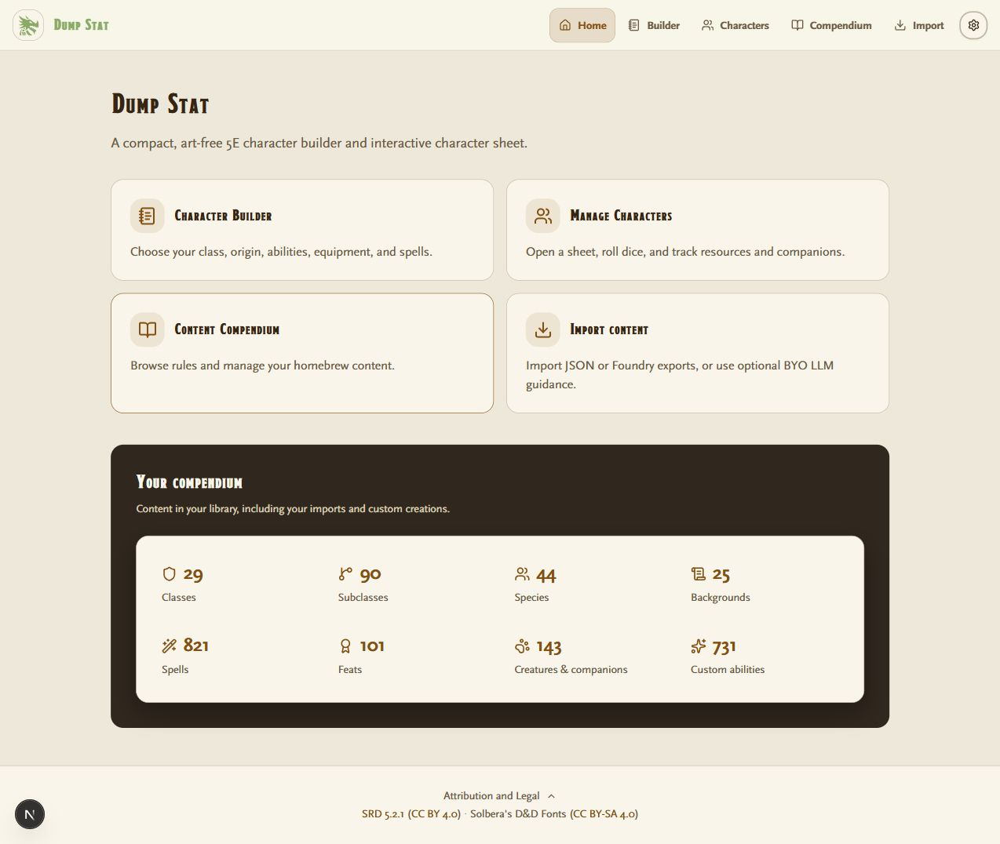
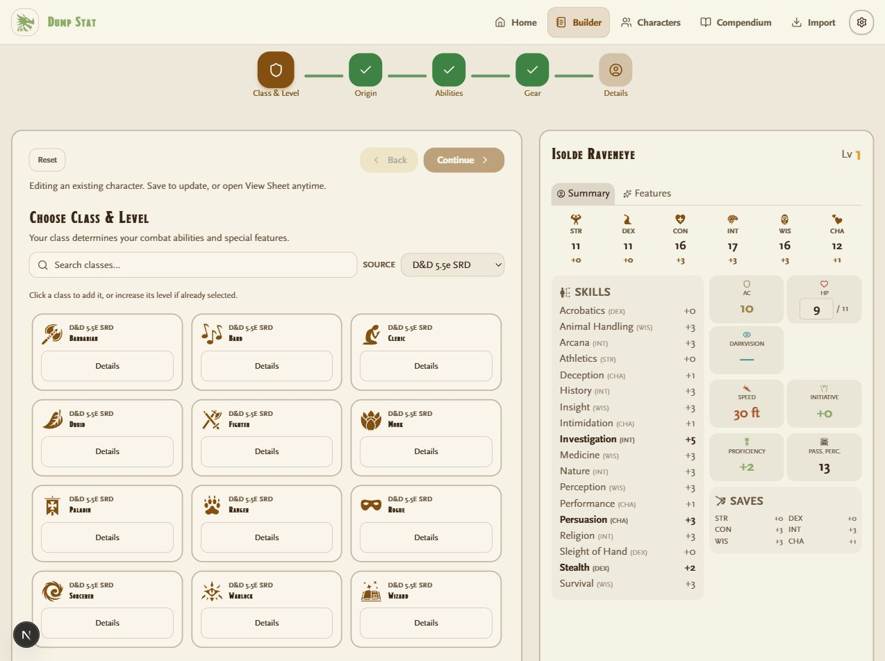
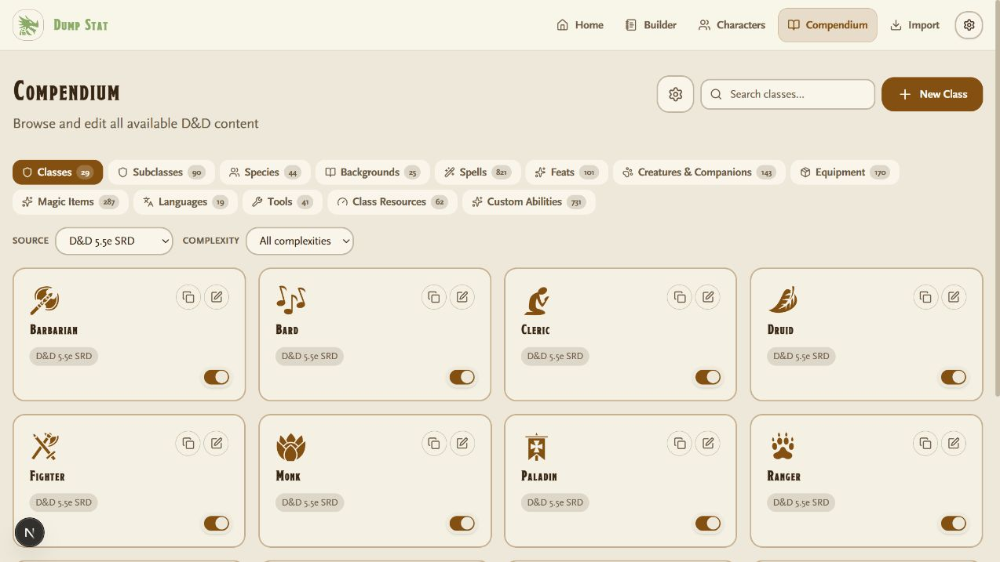
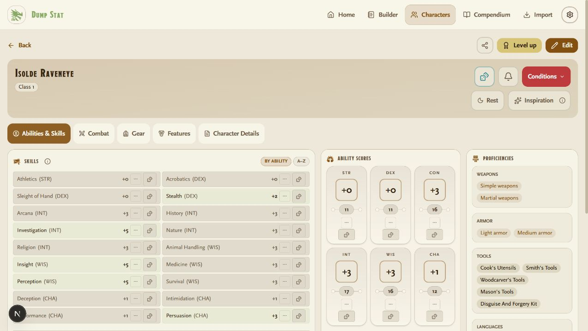

# Dump Stat — Compact Edition

[](https://geph.github.io/Dump-Stat-Character-Builder-5.5e/)

A compact, art-free 5.5e character builder, customizable compendium, and interactive character sheet.

## Functionality

- Step-by-step character creation and level-up, with spell and feature descriptions.
- Dice rolls, HP, spell slots, resources, conditions, and companions.
- Editable compendium, JSON/Foundry import, shared modifier wiring, and optional BYO prompts.
- SRD 5.2.1 and the existing approved optional KibblesTasty/Mage Hand Press packs.
- Browser persistence and export backups. Data is not migrated automatically between site URLs.

### Character builder

Choose your class, origin, abilities, equipment, and spells alongside a live character preview.



### Content compendium

Browse and manage classes, spells, creatures, equipment, and custom content in an art-free catalog.



### Interactive character sheet

Keep ability scores, skills, proficiencies, combat, and character details close at hand.



## Run locally

Use Node **24.21.0 LTS** (`.nvmrc`) and **pnpm 11.9.0**. CI uses the same Node pin.

```sh
pnpm install --frozen-lockfile
# Copy .env.example to .env.local (browser storage by default).
pnpm dev
```

Open http://localhost:3002. For a GitHub Pages export, run `pnpm build:static`. Hosted MySQL remains supported; configure `NEXT_PUBLIC_DEPLOY_MODE=hosted` and your database credentials locally.

## Contributing

See [CONTRIBUTING.md](CONTRIBUTING.md) and [import documentation](docs/import.md). Never copy image sources or private rulebook extracts into this repository.

Run `pnpm check:compact`, `pnpm core:check`, `pnpm lint`, `pnpm exec tsc --noEmit`, `pnpm test`, and `pnpm build:static`. The compact edition tests that artwork cannot be bundled or rendered.

## Attribution

Software is MIT; see [LICENSE](LICENSE) and [NOTICE.md](NOTICE.md). SRD 5.2.1 is CC BY 4.0, with attribution in the app. Publisher pack permissions and scope remain documented in [lib/seed-packs/README.md](lib/seed-packs/README.md). Interface icons and fonts retain their separate notices.
